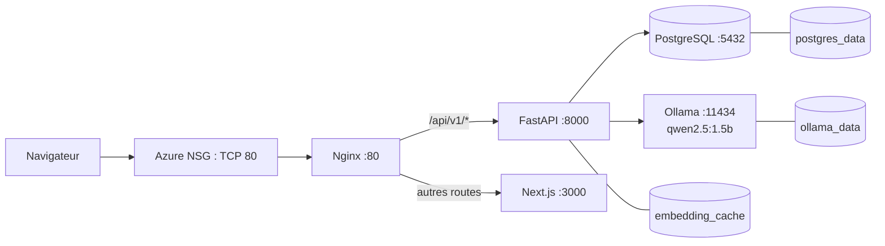

# Rapport technique de déploiement Azure — JobTest

**Date du déploiement et de l'audit : 13 septembre 2026.** Ce document est un
constat technique fondé sur le dépôt courant, son diff Git, les fichiers de
déploiement, les journaux Docker et l'état live de la VM. Les secrets, clés,
jetons et mots de passe sont volontairement absents. Les paramètres Azure fournis
par le porteur du projet sont signalés comme *déclarés* lorsque l'API Azure n'a pas
été interrogée.

## 1. Résumé exécutif

L'objectif était de déployer la version supportée de JobTest : frontend Next.js,
API FastAPI/SQLAlchemy, PostgreSQL, Ollama et Nginx sur une VM Azure Ubuntu. Le
résultat observé est un stack Docker Compose à cinq conteneurs sains, accessible
en HTTP à l'adresse `http://20.51.167.202`. Nginx est le seul service publié.

Il s'agit d'un environnement PFE/démonstration, non d'une production à haute
disponibilité : une VM, une base unique, pas de domaine ni TLS, et un LLM CPU.
Les actions restantes sont la mise en place d'un nom de domaine et d'un certificat
TLS si le projet doit être exposé durablement, ainsi que la déallocation de la VM
hors démonstration.

## 2. État initial du dépôt

Avant ce travail, le dépôt contenait `docker-compose.yml`, `Dockerfile.api` et
`Dockerfile.frontend`. Le Compose lançait PostgreSQL, FastAPI et le frontend
Streamlit sur 8501 ; il ne construisait ni ne lançait `web/`, l'application
Next.js supportée. `Dockerfile.frontend` était une image Python destinée à
Streamlit, pas une image Node/Next.js. `PFE_REPORT.md` confirme que `frontend/`
est déprécié et que `web/` est le frontend actuel.

Les défauts préexistants ayant affecté le déploiement étaient :

- une ligne `bcrypt` dupliquée et encodée avec des octets NUL en fin de
  `requirements.txt`, rendant le fichier non fiable pour `pip` ;
- l'import de `pydantic_settings` par `src/config.py` sans dépendance explicite ;
- l'exclusion de `evaluation/results/` et `evaluation/figures/` par
  `.dockerignore`, alors que l'API les sert à l'interface Quality Center ;
- une variable CORS séparée par des virgules : avec `pydantic-settings`, le type
  `list[str]` doit recevoir un tableau JSON lorsqu'il provient de l'environnement.

Les algorithmes, poids, seuils, décision, checkpoint et résultats de benchmark
n'ont pas été modifiés.

## 3. Infrastructure Azure

Les éléments suivants sont déclarés par le demandeur : VM `vm-jobtest-pfe`, groupe
`rg-jobtest-pfe`, région East US, Ubuntu Server 24.04 LTS, taille
Standard D2as_v7, 2 vCPU, 8 GiB RAM, disque OS StandardSSD_LRS, IP publique
`20.51.167.202` et arrêt automatique à 02:02 (W. Europe Standard Time). L'identité
de facturation et le solde de crédits n'ont pas été inspectés. Le contexte est un
abonnement à crédits/essai/éducation : l'arrêt complet de la VM est donc important.

Le format 8 GiB a été retenu car le projet documente qwen2.5:1.5b comme modèle
local adapté à une machine CPU de mémoire comparable. La contrepartie est une
latence LLM notable. Une swap persistante de 4 GiB a été configurée ; l'état live
montre `/swapfile`, 4 GiB, priorité -2.

**Stop** arrête l'OS mais peut conserver l'allocation et donc les coûts de calcul.
**Stop (deallocate)** libère l'allocation de calcul : les disques gérés et leurs
données persistent, mais une IP publique dynamique peut changer au redémarrage.

## 4. Architecture finale

Le navigateur appelle l'IP publique. Une règle NSG Azure effective doit autoriser
TCP 80 ; Nginx reçoit ensuite la requête. `/api/v1/*` est relayé vers FastAPI et
tout autre chemin est relayé vers Next.js. FastAPI joint PostgreSQL et Ollama sur
le réseau Docker `jobtest_jobtest`, par les noms de service `db` et `ollama`.



Nginx est public ; Next.js, FastAPI, PostgreSQL et Ollama ne possèdent aucune
publication de port hôte. Le réseau Compose est un bridge dédié et les données
persistantes sont les volumes nommés `jobtest_postgres_data`,
`jobtest_ollama_data` et `jobtest_embedding_cache`.

## 5. Inventaire des services et ports

| Service | Conteneur observé | Port interne | Exposition hôte/publique | Health-check | Volume |
|---|---|---:|---|---|---|
| Nginx | `jobtest-nginx-1` | 80 | `0.0.0.0:80`, public HTTP | `wget` local | configuration montée en lecture seule |
| Next.js | `jobtest-web-1` | 3000 | aucune | requête Node locale | aucun |
| FastAPI | `jobtest-api-1` | 8000 | aucune | `GET /api/v1/health` local | `embedding_cache` |
| PostgreSQL | `jobtest-db-1` | 5432 | aucune | `pg_isready` | `postgres_data` |
| Ollama | `jobtest-ollama-1` | 11434 | aucune | `ollama list` | `ollama_data` |

L'état live signale les cinq services `healthy`, une politique
`restart: unless-stopped` et zéro redémarrage inattendu pour chacun.

## 6. Modifications du dépôt

| Chemin relatif | Statut vérifié | Rôle et décision technique |
|---|---|---|
| `Dockerfile.api` | modifié | image Python 3.11 multi-stage, PyTorch CPU puis dépendances ; utilisateur non privilégié `app` |
| `web/Dockerfile` | créé | image Node 20 multi-stage pour build et runtime Next.js |
| `docker-compose.yml` | modifié | stack à cinq services, volumes, réseau, health-checks, aucun Streamlit |
| `deploy/nginx/default.conf` | créé | proxy inverse public et routes API/front |
| `.env.example` | modifié | modèle sans secret, CORS JSON et URL interne Ollama |
| `.dockerignore` | modifié | exclusion des secrets/front local tout en conservant les assets Quality Center |
| `web/.dockerignore` | créé | exclusion de `node_modules`, `.next` et environnements locaux |
| `requirements.txt` | modifié | suppression de la ligne bcrypt corrompue et ajout de `pydantic-settings` |
| `web/lib/api/client.ts` | modifié | fallback API `/api/v1`, non `localhost:8000` |
| `DEPLOYMENT.md` | créé | exploitation, sauvegarde, mise à jour et maîtrise des coûts |
| `AZURE_DEPLOYMENT_REPORT.md` | créé | présent rapport |

Les changements Git préexistants dans `HowToRun.txt`, `src/api/main.py`,
`src/config.py`, `web/package*.json`, `PFE_REPORT.md` et `SECURITY_AUDIT.md` ne
sont pas attribués au déploiement sur la seule base du statut Git courant.

## 7. Conteneurisation backend

`Dockerfile.api` utilise `python:3.11-slim` en étape de construction et d'exécution.
PyTorch provient de l'index CPU officiel ; il est installé avant les dépendances
afin d'éviter le téléchargement concurrent d'une variante PyPI incompatible. Le
runtime conserve `libgomp1`, copie l'environnement Python résolu, copie le code
en propriétaire `app` (UID 10001), puis lance :

```text
uvicorn src.api.main:app --host 0.0.0.0 --port 8000 --workers 1
```

Le checkpoint `models/checkpoints/hybrid.pkl`, le dictionnaire de compétences,
les résultats et figures d'évaluation sont présents dans `/app` (contrôle live).
Au démarrage, `Base.metadata.create_all()` puis `ensure_schema(engine)` exécutent
le mécanisme existant, additif et idempotent ; aucune migration destructive n'a
été ajoutée. Le cache Hugging Face persiste dans `embedding_cache`.

Variables pertinentes : `DATABASE_URL`, `JWT_SECRET_KEY`, `ALLOWED_ORIGINS`,
`OLLAMA_BASE_URL=http://ollama:11434`, `OLLAMA_MODEL=qwen2.5:1.5b`,
`TOKENIZERS_PARALLELISM=false`, `OMP_NUM_THREADS=2` et `MKL_NUM_THREADS=2`.

## 8. Conteneurisation Next.js

`web/Dockerfile` comporte les étapes `deps`, `builder` et `runtime` avec
`node:20-bookworm-slim`. Il exécute `npm ci`, puis `npm run build`, et démarre avec
`npm run start` sur 3000 sous l'utilisateur `nextjs` (UID 10001). Le mode Next.js
`output: standalone` n'est pas utilisé : le runtime copie `node_modules`,
`.next`, `public` et `package.json`.

L'argument de build `NEXT_PUBLIC_API_BASE=/api/v1` et le fallback TypeScript
`/api/v1` imposent le même origin public. `web/.env.local` peut toujours surcharger
cette valeur en développement. Streamlit n'est ni construit ni démarré par le
Compose final.

## 9. PostgreSQL

Le service utilise `postgres:16-alpine`. La base et l'utilisateur sont initialisés
par les variables `POSTGRES_DB`, `POSTGRES_USER` et `POSTGRES_PASSWORD`, sans
valeur documentée ici. Les données sont dans `jobtest_postgres_data`. Le service
est uniquement sur le réseau Docker ; `ss -ltn` sur la VM ne montre pas 5432 et
un test externe confirme le port inaccessible.

La sauvegarde logique recommandée est :

```bash
cd /opt/jobtest
docker compose exec -T db sh -c 'pg_dump -U "$POSTGRES_USER" "$POSTGRES_DB"' \
  | gzip > jobtest-$(date +%F).sql.gz
```

Pour restaurer sur une instance cible explicitement préparée :

```bash
gunzip -c sauvegarde.sql.gz | docker compose exec -T db \
  sh -c 'psql -U "$POSTGRES_USER" "$POSTGRES_DB"'
```

## 10. Ollama et couche IA

Ollama utilise `ollama/ollama:0.5.13`, `OLLAMA_KEEP_ALIVE=10m` et le volume
`jobtest_ollama_data`. Le modèle `qwen2.5:1.5b` a été téléchargé avec `ollama pull`
et est observé à 986 MB. FastAPI le joint via `http://ollama:11434` ; le port n'est
ni mappé sur l'hôte ni accessible depuis Internet.

La couche 2 reste consultative : elle reçoit les résultats de la couche 1 et ne
détermine ni le score officiel ni la décision HIRE/CONSIDER/REJECT. Une analyse
profonde a retourné `status=ok`, les cinq rubriques attendues et une latence de
**54 290,6 ms**. Sur CPU, cette latence est normale pour ce profil VM.

## 11. Nginx et réseau

La configuration montée en lecture seule fixe `client_max_body_size 15m`, les
en-têtes `X-Content-Type-Options: nosniff`, `X-Frame-Options: SAMEORIGIN` et
`Referrer-Policy: strict-origin-when-cross-origin`. `/api/v1/` est relayé vers
`api:8000` avec des délais de connexion 10 s et lecture/envoi 180 s ; `/` est
relayé vers `web:3000`. Ainsi `/api/v1/docs`, `/api/v1/health` et les ressources
API suivent le proxy API.

UFW est observé `inactive`. La connectivité externe actuelle confirme TCP 80 et
HTTP 200 pour l'accueil et Swagger. Elle prouve qu'une autorisation NSG effective
existe ; son nom, sa priorité et son niveau (NIC ou sous-réseau) ne sont pas
vérifiables sans accès Azure API/Portal. Si elle doit être recréée : TCP, port de
destination 80, action Allow, priorité non conflictuelle, en gardant TCP 22.

HTTP est temporaire. HTTPS ne doit pas être revendiqué sans domaine et certificat
valide.

## 12. Mesures de sécurité

Les secrets ont été générés localement sur la VM avec une source aléatoire, placés
uniquement dans `/opt/jobtest/.env`, ignorés par Git et les contextes Docker. Le
fichier est observé avec le mode `0600`, propriétaire `iheb:iheb`. Les exemples
utilisent des marqueurs non exploitables.

L'API et le frontend tournent sous utilisateurs non-root. PostgreSQL, Ollama,
FastAPI et Next.js ne sont pas publiés. CORS contient l'origine HTTP publique et
l'origine locale sous forme de tableau JSON. SSH reste le seul autre accès réseau
nécessaire.

Les risques résiduels documentés restent : HTTP sans chiffrement, VM unique,
authentification sans verrouillage de compte, validation d'upload principalement
basée sur l'extension, fallback DOCX XML, et texte CV/JD non fiable dans la couche
LLM consultative. Ils ne sont pas résolus par le déploiement.

## 13. Procédure de déploiement reconstituée

### Commandes attestées par la session de déploiement

Les commandes suivantes ont été exécutées ou leurs résultats ont été capturés :

```bash
# connexion (chemin de clé volontairement abstrait)
ssh -i "<PEM_PATH>" iheb@20.51.167.202

sudo apt-get update
sudo apt-get install -y ca-certificates curl
# ajout du dépôt officiel Docker pour Ubuntu noble
sudo apt-get install -y docker-ce docker-ce-cli containerd.io \
  docker-buildx-plugin docker-compose-plugin
sudo systemctl enable --now docker
sudo usermod -aG docker iheb

sudo fallocate -l 4G /swapfile
sudo chmod 600 /swapfile
sudo mkswap /swapfile
sudo swapon /swapfile

git clone --depth 1 https://github.com/ElEchIheb/Cv_Job_Similarity_ML.git /opt/jobtest
docker compose build
docker compose up -d db ollama
docker compose exec -T ollama ollama pull qwen2.5:1.5b
docker compose up -d api web nginx
```

Un archive du workspace courant a ensuite été superposé au clone afin de déployer
la source de vérité locale non encore publiée, sans `.env`, clé SSH, base locale,
`node_modules` ni `.next`. Le build initial par wheel a échoué sur deux versions
de `filelock`; `Dockerfile.api` a été corrigé puis le build a réussi. Le cache de
build Docker a été purgé, sans suppression d'image utilisée ni de volume.

Le format CORS a été corrigé de liste séparée par virgules vers tableau JSON après
l'erreur `pydantic-settings`, puis l'API a été recréée. Ces faits sont attestés
par les sorties de déploiement et les journaux de démarrage.

### Éléments inférés ou non vérifiables

La création exacte de la règle NSG, sa priorité et son auteur ne figurent pas dans
le dépôt ni les journaux de la VM. Son existence effective est inférée de la
connectivité actuelle de TCP 80. L'heure exacte de chaque commande système hors
journaux Docker n'est pas reconstruisible depuis l'historique shell non
interactif.

## 14. Vérifications et résultats

| Vérification | Résultat | Preuve |
|---|---|---|
| Conteneurs | Réussi | 5/5 `healthy`, 0 restart | 
| Nginx | Réussi | `nginx -t` valide | 
| Frontend public | Réussi | HTTP 200 externe | 
| Swagger public | Réussi | HTTP 200 externe sur `/api/v1/docs` | 
| API | Réussi | `/api/v1/health` et detailed health `ok` | 
| Inscription/connexion | Réussi | compte de vérification créé et JWT utilisé sans l'afficher | 
| Offre d'emploi | Réussi | offre ID 1 créée | 
| Évaluation CV | Réussi | MatchResult ID 1, décision `CONSIDER`, 22 109,54 ms au premier chargement | 
| Explication/composants | Réussi | TF-IDF, embedding, skills et champs d'explication retournés | 
| PDF | Réussi | 112 039 octets, PDF 1.4, 2 pages | 
| Ollama | Réussi | health disponible, modèle présent | 
| Deep Analysis | Réussi | `ok`, 54 290,6 ms | 
| Persistance PostgreSQL | Réussi | `count(match_results)=1`, `count(llm_analysis_json)=1` | 
| Ports internes | Réussi | 5432/11434/8000/3000 inaccessibles depuis Internet | 
| OOM/crash | Réussi | aucun motif OOM/fatal/panic dans logs inspectés | 

Les logs Nginx enregistrent notamment les réponses 200 de l'évaluation, du PDF
(112039 octets) et de Deep Analysis. La validation ne constitue pas une preuve de
charge ou de haute disponibilité.

## 15. Guide d'exploitation

```bash
ssh -i "<PEM_PATH>" iheb@20.51.167.202
cd /opt/jobtest

docker compose ps
docker compose logs -f --tail=200 nginx api web ollama db
docker compose restart
docker compose down                 # conserve les volumes
docker compose up -d
docker compose exec -T ollama ollama list
free -h; swapon --show; df -h /
ss -ltn
curl -fsS http://127.0.0.1/api/v1/health
curl -fsS http://127.0.0.1/api/v1/health/detailed
```

Mise à jour sûre : sauvegarder PostgreSQL, conserver `.env`, committer et revoir
la version souhaitée sur le poste de travail, puis transférer une archive Git
sans secrets :

```bash
# poste de travail, après commit de la version voulue
git archive --format=tar.gz --output=jobtest-release.tar.gz HEAD
scp -i "<PEM_PATH>" jobtest-release.tar.gz iheb@20.51.167.202:/tmp/

# VM
cd /opt/jobtest
tar -xzf /tmp/jobtest-release.tar.gz -C /opt/jobtest
docker compose --env-file .env.example config --quiet
docker compose up -d --build
```

Ne pas exécuter `docker compose down -v` sauf intention explicite d'effacer les
données PostgreSQL et caches persistants.

## 16. Démarrage et arrêt Azure

Dans Azure Portal : démarrer `vm-jobtest-pfe`, attendre l'état Running, relever
l'IP publique et adapter l'URL si l'IP est dynamique. Se connecter puis lancer
`cd /opt/jobtest && docker compose ps` : Docker est activé au boot et les services
ont une politique `unless-stopped`.

Après une démonstration : Azure Portal → Virtual machines → `vm-jobtest-pfe` →
Stop → **Stop (deallocate)**. Les disques, le dépôt `/opt/jobtest`, les volumes
Docker et les modèles persistent ; le calcul est libéré. Vérifier l'éventuel
changement d'IP dynamique au prochain démarrage.

## 17. Limites et travaux restants

- HTTP seulement, sans domaine ni TLS ;
- IP publique potentiellement dynamique ;
- architecture mono-VM sans réplication, load balancing ni haute disponibilité ;
- LLM CPU lent et dépendant de la mémoire disponible ;
- espace disque limité : l'état audité affiche 23 GiB utilisés sur 29 GiB ;
- crédits Azure limités dans le temps ;
- déploiement prévu pour PFE/démonstration, pas un service permanent 24/7 ;
- la règle NSG est fonctionnelle mais ses détails administratifs ne sont pas
  documentés par une preuve Azure API dans ce dépôt.

## 18. Synthèse prête pour le mémoire

## Déploiement de la solution JobTest sur Microsoft Azure

La solution JobTest a été déployée sur une machine virtuelle Microsoft Azure sous
Ubuntu Server 24.04 LTS. L'architecture retenue repose sur Docker Compose et
regroupe un frontend Next.js, une API FastAPI, une base PostgreSQL, le moteur LLM
local Ollama et Nginx comme point d'entrée unique. Nginx publie exclusivement le
port HTTP 80 et distribue les requêtes : les routes `/api/v1/*` sont transmises à
FastAPI, tandis que les autres routes sont servies par Next.js. PostgreSQL,
Ollama, l'API et le frontend restent internes au réseau Docker, sans exposition
directe sur Internet.

Le déploiement conserve les données métier dans un volume PostgreSQL, les modèles
Ollama dans un volume dédié et les embeddings téléchargés dans un cache persistant.
L'API initialise son schéma par le mécanisme additif déjà présent dans le projet,
sans migration destructive. La couche statistique conserve le checkpoint de
production et les ressources d'évaluation du dépôt. La couche LLM qwen2.5:1.5b
est exécutée localement par Ollama ; elle fournit une analyse qualitative
consultative et ne modifie ni le score ni la décision officielle de recrutement.

Les tests effectués ont validé le chargement du frontend, la documentation Swagger,
l'authentification, la création d'offre, l'évaluation et la persistance d'un
MatchResult, la génération PDF ainsi qu'une analyse approfondie réussie en
54,29 secondes sur CPU. La solution est donc opérationnelle pour une démonstration
PFE. Elle doit toutefois évoluer vers HTTPS avec domaine et certificat, ainsi que
vers une architecture plus tolérante aux pannes, avant toute exploitation durable.

## Annexe : faits de `PFE_REPORT.md` rendus obsolètes

La section de déploiement antérieure indiquait qu'aucune configuration Azure, aucun
Dockerfile Next.js et aucune topologie Azure concrète n'étaient présents, et que le
Compose déployait Streamlit. Ces constats historiques sont désormais obsolètes :
le dépôt contient le Compose à cinq services, le Dockerfile Next.js, Nginx, la
documentation d'exploitation et le déploiement live Azure décrit ci-dessus.
`PFE_REPORT.md` n'a pas été modifié dans le cadre de cet audit.
