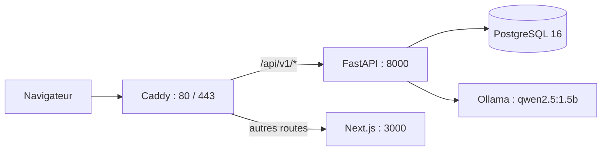

# Rapport de migration Azure — JobTest

**Date :** 12 octobre 2026  
**Objet :** transfert du déploiement JobTest et de ses données PostgreSQL vers un nouvel abonnement Azure.  
**État au terme de l'intervention :** application accessible en HTTPS et données restaurées.

Ce rapport décrit les opérations réalisées pour la migration. Les mots de passe, la clé SSH privée et les secrets applicatifs ne sont pas reproduits ici. Les résultats de vérification cités ci-dessous ont été observés pendant l'intervention ; ils ne constituent pas une garantie de disponibilité future.

## 1. Situation de départ et cible

Le projet était hébergé sur une VM Azure de l'ancien abonnement, dont la période d'essai était terminée. La demande était de le réhéberger dans un nouvel abonnement à crédits d'essai en conservant, si possible, les données PostgreSQL.

| Élément | Ancien hébergement | Nouvel hébergement |
| --- | --- | --- |
| Abonnement Azure | `9552bd87-ee32-4302-8788-b9e558dc0688` | `1c03a372-35c0-4c27-a3a6-bbdbe2e237f5` |
| Groupe de ressources | `rg-jobtest-pfe` | `rg-jobtest-pfe` |
| Machine virtuelle | `vm-jobtest-pfe` | `vm-jobtest-pfe` |
| Région | East US | East US |
| IP publique | `20.51.167.202` | `20.75.163.163` (statique) |
| Point d'accès | ancienne VM | <https://jobtest-pfe-iheb.eastus.cloudapp.azure.com/> |

Les noms de groupe et de VM sont identiques dans les deux abonnements : il s'agit bien de ressources distinctes. La nouvelle VM utilise Ubuntu Server 24.04 LTS et la taille **Standard D2as v7**, soit 2 vCPU et 8 Gio de RAM.

## 2. Préparation du nouvel hébergement

1. La structure du projet et le déploiement existant ont été examinés : frontend Next.js (`web/`), API FastAPI, PostgreSQL, Ollama et proxy HTTP.
2. La nouvelle VM a été créée dans le nouvel abonnement avec une IP publique statique. Une nouvelle clé SSH locale a été créée pour l'accès administrateur `iheb`. Sa partie privée reste sur ce PC, à `C:\Users\ihebe\.ssh\jobtest_azure_iheb_2026`.
3. Le code du projet a été transféré sous `/opt/jobtest` sur la VM. Le script [`deploy/provision_vm.sh`](deploy/provision_vm.sh) installe Docker Engine et le plugin Compose depuis le dépôt officiel Docker, active le service et prépare un fichier d'échange persistant de 4 Gio.
4. Le fichier `/opt/jobtest/.env` a été créé sur la VM avec des secrets de base de données et JWT générés aléatoirement. Son mode est `0600`. Il contient aussi les paramètres CORS et les adresses internes des services.
5. Les images de l'API et du frontend ont été construites sur la VM. Le modèle Ollama `qwen2.5:1.5b` a été téléchargé. Les cinq services ont ensuite été démarrés avec Docker Compose.

Le Dockerfile du frontend a reçu `RUN mkdir -p public && npm run build` afin que la construction fonctionne aussi quand le dossier `public/` n'existe pas dans la source transférée.

## 3. Architecture déployée

Le fichier [`docker-compose.yml`](docker-compose.yml) décrit les cinq services actifs : `db` (PostgreSQL 16), `ollama`, `api` (FastAPI), `web` (Next.js) et `caddy`. Les quatre premiers communiquent sur le réseau Docker interne ; Caddy publie les ports 80 et 443 de la VM.



La configuration [`deploy/Caddyfile`](deploy/Caddyfile) distribue `/api/v1/*` vers l'API et les autres routes vers Next.js. Elle fixe une limite de corps de requête de 15 Mo et des en-têtes de sécurité. Caddy obtient et renouvelle le certificat Let's Encrypt ; les requêtes HTTP sont redirigées vers HTTPS avec le code `308`.

Les volumes Docker persistants conservent la base PostgreSQL, le modèle Ollama, le cache des embeddings et les données nécessaires à Caddy pour TLS. La configuration publique de l'API utilise le même domaine HTTPS pour CORS.

## 4. Transfert de la base PostgreSQL

Une sauvegarde logique de PostgreSQL 16 a été extraite de l'ancienne VM au format personnalisé `pg_dump -Fc`. Le fichier a été conservé localement à :

`D:\education\pfe\jobtest-postgres-old-20261012.dump`

Son empreinte SHA-256, recalculée après l'intervention, est :

`8a5a08f1a88c202a615ad15d1befcd468a8d7376e80f258e75d41a24f5eacfd6`

La sauvegarde a été restaurée dans la base PostgreSQL du nouveau déploiement avec `pg_restore`. Les comptages suivants ont été comparés avant et après migration, puis revérifiés sur la nouvelle VM :

| Table | Ancienne base | Nouvelle base |
| --- | ---: | ---: |
| `users` | 2 | 2 |
| `candidates` | 32 | 32 |
| `job_offers` | 3 | 3 |
| `cvs` | 32 | 32 |
| `match_results` | 32 | 32 |

Cette comparaison confirme les effectifs de ces cinq tables. Elle ne remplace pas un contrôle détaillé de chaque enregistrement. Le fichier de sauvegarde contient des données de recrutement et reste hors du dépôt Git.

## 5. Domaine et chiffrement

Une étiquette DNS Azure a été associée à l'IP publique statique `20.75.163.163`. Le domaine final est :

**<https://jobtest-pfe-iheb.eastus.cloudapp.azure.com/>**

Le nom DNS historique `jobtest.eastus.cloudapp.azure.com` a été retiré de l'ancienne IP, mais Azure le déclarait encore indisponible au moment de la configuration de la nouvelle IP. Le domaine final ci-dessus a donc été utilisé. Caddy a obtenu un certificat Let's Encrypt valide pour celui-ci.

## 6. Vérifications effectuées

| Contrôle | Résultat observé |
| --- | --- |
| Résolution DNS | `jobtest-pfe-iheb.eastus.cloudapp.azure.com` → `20.75.163.163` |
| Page publique HTTPS | code HTTP `200` ; validation du certificat `curl` = `0` |
| API `/api/v1/health` | code HTTP `200`, `status: ok`, version `2.0.0` |
| Accès HTTP | redirection `308` vers le domaine HTTPS |
| Docker Compose | cinq services actifs ; `db`, `ollama`, `api` et `web` sains au contrôle |
| Certificat TLS | journal Caddy : `certificate obtained successfully` pour le domaine final |
| Données PostgreSQL | effectifs des cinq tables du §4 conservés |
| Interface | page de connexion ouverte et examinée dans le navigateur intégré |

Ces contrôles prouvent que le service répondait et que les données comptées étaient présentes à la fin de la migration. Aucun essai de charge ni test de haute disponibilité n'a été réalisé.

## 7. État de l'ancien hébergement et points d'attention

Après la sauvegarde, l'ancienne VM a été **arrêtée et désallouée**. Son disque et son IP publique existent encore dans l'ancien abonnement pour permettre un retour arrière ; ces ressources peuvent continuer à générer des frais. Le nouveau déploiement utilise les crédits de l'abonnement d'essai, selon les conditions et la durée de validité de ce dernier.

La nouvelle architecture repose sur une seule VM et une seule instance PostgreSQL. Une panne de cette VM rendrait l'application indisponible jusqu'à sa remise en service. La sauvegarde locale du §4 doit être conservée en lieu sûr et une politique de sauvegarde régulière reste nécessaire pour les données créées après la migration.

## 8. Fichiers et accès utiles

| Élément | Emplacement ou commande |
| --- | --- |
| Résumé opérationnel | [`AZURE_MIGRATION_2026-10-12.md`](AZURE_MIGRATION_2026-10-12.md) |
| Composition des services | [`docker-compose.yml`](docker-compose.yml) |
| Proxy HTTPS | [`deploy/Caddyfile`](deploy/Caddyfile) |
| Provisionnement VM | [`deploy/provision_vm.sh`](deploy/provision_vm.sh) |
| Dockerfile frontend | [`web/Dockerfile`](web/Dockerfile) |
| Projet sur la VM | `/opt/jobtest` |
| Clé SSH privée locale | `C:\Users\ihebe\.ssh\jobtest_azure_iheb_2026` |

Pour contrôler le déploiement :

```powershell
ssh -i 'C:\Users\ihebe\.ssh\jobtest_azure_iheb_2026' iheb@20.75.163.163
cd /opt/jobtest
sudo docker compose ps
sudo docker compose logs --tail=100 api caddy
```

Ne pas lancer `docker compose down -v` : cette commande supprimerait les volumes persistants, dont celui de PostgreSQL.
